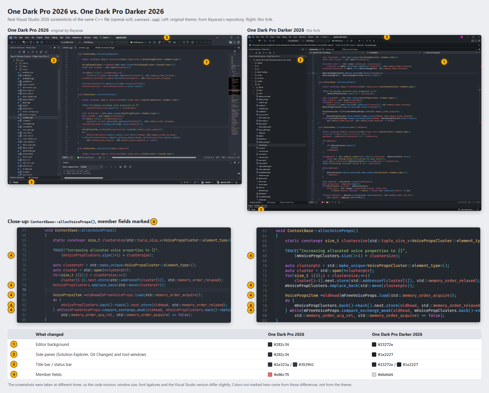
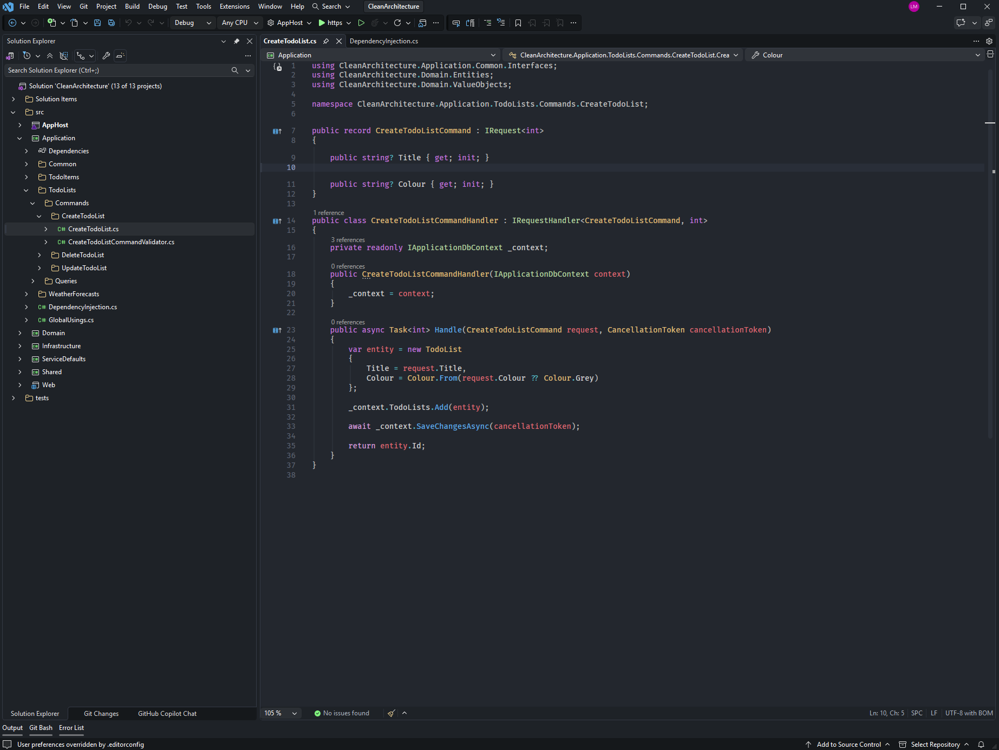
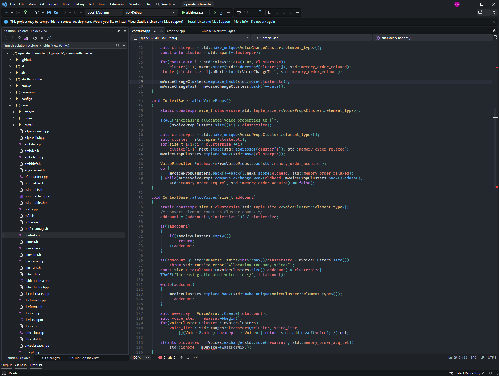

## One Dark Pro Darker 2026

> A darker variant of [One Dark Pro 2026](https://github.com/bayaraa/OneDarkPro2026) by [Bayaraa](https://github.com/bayaraa), released under the MIT license. This is a fork, not the original theme. If you want the standard One Dark Pro look, install Bayaraa's extension instead.

The original One Dark Pro 2026 uses the classic One Dark editor gray (`#282c34`). This variant follows the **Darker** palette that [Binaryify's One Dark Pro for VS Code](https://github.com/Binaryify/OneDark-Pro/blob/master/themes/OneDark-Pro-darker.json) ships as a separate theme. The editor and the IDE around it are darker, and a few syntax colors are reassigned so that members and types are easier to tell apart.

---

## What this variant changes

| Element | One Dark Pro 2026 | One Dark Pro Darker 2026 |
|---|---|---|
| Editor background, selected tab | `#282c34` | `#23272e` |
| Side panes (Solution Explorer, Git Changes, …), tool windows, tab strip | `#282c34` | `#1e2227` |
| Status bar | `#353941` | `#1e2227` |
| Title bar | `#2e323a` | `#23272e` |
| Fields | `#e06c75` (red) | `#d4d4d4` (near-white) |
| Properties | `#d19a66` (orange) | `#d4d4d4` (near-white) |
| Constants and enum members | `#b8d7a3` (green) | `#d4d4d4` (near-white) |
| Interfaces, enums, and generic type parameters | `#e5c07b` (yellow) | `#b8d7a3` (green) |

ReSharper's matching identifier colors (C#, C++, TypeScript) follow the same mapping. Everything else in the editor, including keywords, strings, comments, methods, and local variables, keeps the One Dark Pro 2026 colors. Hover, border, and button colors across the IDE are shifted one step darker to match the new backgrounds.

The side panes are one step darker than the editor, so the code area stands out from the surrounding tool windows.



*Real Visual Studio 2026 screenshots of the same file. Left: the original theme, from Bayaraa's repository. Right: this fork.*

---

## Screenshots





---

## Building from source

The theme is defined in a single YAML file and packaged with the Python build script inherited from the original project. You need **Python 3.8+** and **PyYAML**:

```sh
pip install pyyaml
python build_vsix.py -i OneDarkProDarker2026.yaml -o OneDarkProDarker2026
```

This produces `OneDarkProDarker2026.vsix`, which you can install by double-clicking it.

### Releases

To publish a release, bump `Version` in `OneDarkProDarker2026.yaml` and push to `main`. The [Release workflow](.github/workflows/release.yml) builds the `.vsix`, tags the commit `vX.Y.Z`, and attaches the file to a new GitHub release. If that version is already tagged, the workflow does nothing.

| File | Purpose |
|---|---|
| `OneDarkProDarker2026.yaml` | Theme metadata and every color entry |
| `build_vsix.py` | Converts the YAML into a `.pkgdef` and packs the `.vsix` |
| `OneDarkProDarker2026.png` | Extension icon |

### Tweaking the darker surfaces

In Visual Studio 2026, panes draw their background from the shared `Shell` surface colors: `SolidBackgroundFillTertiary`, `SolidBackgroundFillBase`, `CardBackgroundFillDefault`, and `LayerFillDefault`. Change these together to change how dark the side panes are. The editor background is set separately, under `Text Editor Text Manager Items`. The older `Environment.ToolWindowBackground` and `TreeView.Background` entries are kept in sync for compatibility.

---

## Credits and license

* **[One Dark Pro 2026](https://github.com/bayaraa/OneDarkPro2026)** by Bayaraa: the base theme, the VS 2026 key fixes, and the YAML-to-VSIX build script. This repository is a fork of it.
* **[One Dark Pro](https://marketplace.visualstudio.com/items?itemName=adrianwilczynski.one-dark-pro)** by Adrian Wilczyński: the Visual Studio theme that One Dark Pro 2026 is based on.
* **[One Dark Pro Darker](https://github.com/Binaryify/OneDark-Pro/blob/master/themes/OneDark-Pro-darker.json)** by Binaryify: the darker VS Code palette this variant follows.

MIT license. The original copyright notice is kept in [LICENSE](LICENSE).
